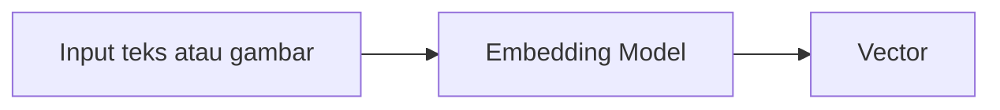
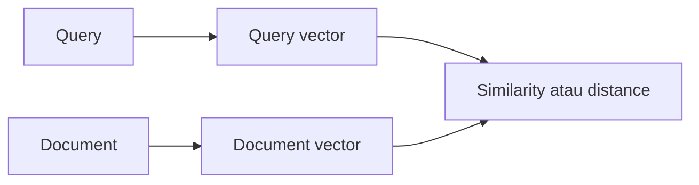
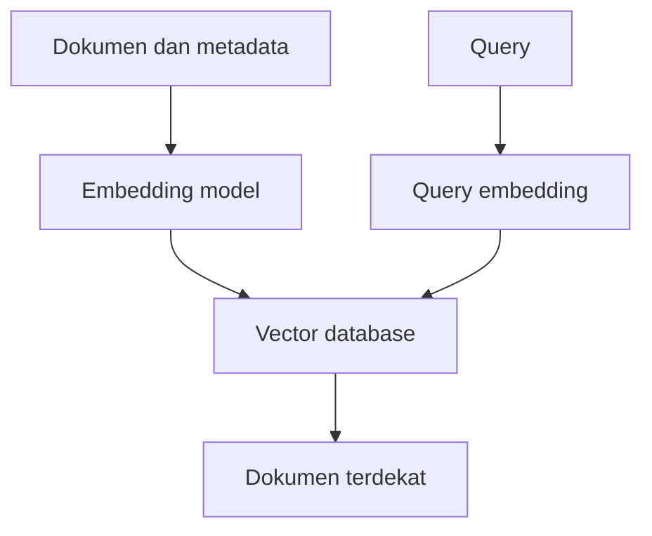

# Embeddings

Embedding adalah representasi data dalam bentuk vector angka. Model embedding mengubah teks, gambar, atau data multimodal menjadi vector yang membawa pola dan makna dari input tersebut.

## Konsep Dasar

Vector menyimpan beberapa nilai numerik pada dimensi tertentu. Data yang memiliki makna atau karakteristik serupa biasanya ditempatkan berdekatan dalam ruang vector, meskipun bentuk teks aslinya berbeda.

Dimensionality menunjukkan jumlah nilai dalam sebuah vector. Dimensi yang lebih besar dapat menyimpan pola yang lebih beragam, tetapi membutuhkan storage dan komputasi yang lebih besar. Kualitas embedding bergantung pada model, bahasa, domain, dan data yang digunakan.

## Embedding Process

Proses embedding menerima input dan menghasilkan vector yang dapat disimpan atau dibandingkan.

Text embedding digunakan untuk kalimat, dokumen, pertanyaan, dan metadata. Image atau multimodal embedding digunakan ketika sistem perlu membandingkan gambar dengan gambar, atau menghubungkan informasi gambar dan teks.

## Semantic Similarity

Semantic similarity mengukur kedekatan makna antara dua vector. Cosine similarity membandingkan arah vector, sedangkan distance mengukur jarak di ruang vector. Nilai dan interpretasinya bergantung pada model serta library yang digunakan.

Similarity dapat digunakan untuk mencari dokumen yang relevan, mencocokkan pertanyaan dengan jawaban, memberi rekomendasi, atau mengelompokkan data. Sistem perlu menguji threshold dengan data nyata karena skor similarity tidak memiliki arti universal di semua model.

## Embedding dalam Sistem AI

Pada semantic search, sistem mengubah query menjadi vector lalu mencari vector dokumen yang paling dekat. Similarity matching membandingkan item yang memiliki karakteristik serupa. Recommendation menggunakan kedekatan vector untuk menemukan item yang mungkin sesuai dengan minat pengguna.

Clustering mengelompokkan vector berdasarkan kedekatan tanpa harus menyediakan label untuk setiap data. Retrieval menggunakan hasil pencarian vector sebagai context untuk model generatif.

## Vector Database

Vector database menyimpan vector bersama identifier, isi sumber, dan metadata. Index membantu database mencari nearest neighbor tanpa membandingkan query dengan setiap vector satu per satu.

Metadata dapat berisi device_id, jenis dokumen, waktu, lokasi, atau access level. Filtering membatasi pencarian berdasarkan metadata sebelum atau sesudah similarity search. Isi sumber perlu disimpan agar aplikasi dapat menampilkan context dan sumber asli setelah menemukan vector yang sesuai.

## Embedding Model

Pemilihan model perlu mempertimbangkan bahasa, domain, dimensionality, latency, lisensi, dan resource. Model yang cocok untuk teks umum belum tentu paling baik untuk istilah teknis atau data sensor.

Perubahan model embedding dapat membuat vector lama tidak kompatibel secara makna. Ketika mengganti model, sistem biasanya perlu membuat ulang embedding dan menguji kembali threshold similarity.
