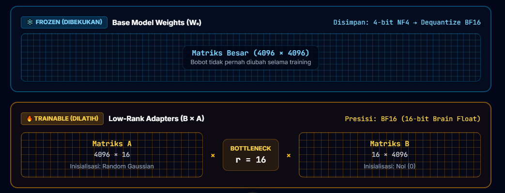

# Fine-tuning LLM

Fine-tuning adalah proses mengubah perilaku model yang sudah dilatih sebelumnya (*pre-trained model*) agar lebih cocok untuk tugas tertentu.

Urutan umumnya adalah **pre-training → post-training/alignment → deployment**. Fine-tuning termasuk dalam tahap post-training. Beberapa caranya adalah *Supervised Fine-Tuning* (SFT), distillation, dan reinforcement learning.

Base model hasil pre-training pada dasarnya mempelajari *next-token prediction*, yaitu melanjutkan teks. Base model belum tentu mengikuti instruksi atau berperilaku seperti asisten. Instruct model telah melalui fine-tuning agar dapat menjawab pertanyaan, mengikuti instruksi, dan menerapkan perilaku yang diharapkan.

## Memilih pendekatan

Fine-tuning dari base model dapat dipakai ketika ingin membentuk perilaku model secara mendasar. Dalam banyak penggunaan industri, titik awalnya adalah instruct model, lalu model disesuaikan untuk spesialisasi domain atau format keluaran tertentu.

### Full fine-tuning

Full fine-tuning memperbarui semua parameter model. Fleksibilitasnya tinggi, tetapi training perlu menyimpan bobot model, gradien, *optimizer state*, dan aktivasi. Karena itu kebutuhan memori dapat beberapa kali ukuran bobot model. Training model besar sering membagi pekerjaan ke banyak GPU:

- **Data parallelism**: setiap GPU memegang salinan model dan memproses bagian data berbeda.
- **Model parallelism**: model dibagi ke beberapa GPU, misalnya dengan *pipeline parallelism* atau *tensor parallelism*.

### Angka presisi dan quantization

Floating point menyimpan nilai dengan bagian tanda (*sign*), eksponen (*exponent*), dan mantisa (*mantissa*). *Quantization* menyimpan bobot dengan lebih sedikit bit untuk mengurangi kebutuhan memori.

| Format | Bit per nilai | Komponen / representasi | Catatan penggunaan |
| --- | ---: | --- | --- |
| FP32 | 32 | 1 bit tanda, 8 eksponen, 23 mantisa | Presisi penuh; kebutuhan memori lebih besar. |
| FP16 | 16 | 1 bit tanda, 5 eksponen, 10 mantisa | Lebih hemat dari FP32; rentang nilai lebih sempit. |
| BF16 | 16 | 1 bit tanda, 8 eksponen, 7 mantisa | Rentang eksponen sama dengan FP32, mantisa lebih pendek. |
| INT8 | 8 | Nilai integer 8-bit; biasanya disertai *scale* dan *zero point* | Pemetaan nilai float ke rentang integer; rentang signed yang umum adalah −128 hingga 127. |
| NF4 | 4 | Indeks ke codebook 16 nilai, dirancang untuk distribusi bobot normal | Digunakan QLoRA untuk menyimpan bobot dasar dengan kebutuhan memori lebih rendah. |

Bit per nilai menunjukkan ukuran representasi dasar. Kebutuhan memori nyata juga dipengaruhi metadata kuantisasi, skala, padding, dan format komputasi.

### Parameter-Efficient Fine-Tuning (PEFT)

PEFT membekukan sebagian besar parameter dan melatih bagian yang lebih kecil. Kelompok metodenya antara lain:

- **Additive methods** menambahkan parameter, seperti adapter pada layer Transformer atau *soft prompt*.
- **Selective methods** memilih sebagian parameter yang sudah ada, misalnya beberapa layer terakhir atau parameter bias.
- **Reparameterization methods** menyatakan perubahan bobot dalam bentuk yang lebih ringkas, seperti LoRA.

## LoRA

LoRA (*Low-Rank Adaptation*) membekukan bobot model dasar dan menambahkan dua matriks adapter yang dilatih. Untuk bobot \(W_0\), perubahan bobot ditulis sebagai \(\Delta W = \frac{\alpha}{r} B A\), sehingga bobot efektifnya \(W = W_0 + \Delta W\). Matriks A memproyeksikan ke dimensi rendah dan B memproyeksikan kembali. Rank \(r\) mengatur ukuran bottleneck; \(\alpha\) mengatur skala kontribusi adapter.

Saat training LoRA, optimizer memperbarui A dan B; bobot dasar tetap. Hyperparameter penting mencakup **rank (r)**, **alpha** sebagai skala kontribusi adapter, dan **target modules** yang dipasangi adapter. Modul yang umum pada attention ialah `q_proj`, `k_proj`, `v_proj`, `o_proj`; pada feed-forward antara lain `gate_proj`, `up_proj`, dan `down_proj`.

## QLoRA

QLoRA menggabungkan bobot dasar yang dikuantisasi dengan pelatihan adapter LoRA. Bobot dasar dapat disimpan dalam 4-bit NF4, sementara komputasi menggunakan representasi presisi lebih tinggi seperti BF16. Bobot dasar dibekukan; adapter menjadi parameter yang dilatih. Ini mengurangi kebutuhan memori dibanding full fine-tuning, tetapi tidak menghilangkan kebutuhan GPU maupun evaluasi kualitas.

## Simulator QLoRA

Pilih ukuran model, GPU, panjang sequence, dan micro-batch untuk melihat estimasi VRAM. Estimator menampilkan kebutuhan per GPU; pada Kaggle T4 × 2 kapasitas tiap perangkat tetap 16 GB. Ketersediaan GPU Colab berubah, jadi cocokkan perkiraan dengan runtime yang benar-benar didapat.

Di bawahnya, jalankan simulasi numerik kecil secara manual atau otomatis. Matriks \(W_0\) tetap beku; langkah SGD hanya memperbarui A dan B. Setiap langkah menghitung \(Ax\), \(W_0x\), \(\Delta y\), prediksi, MSE, dan nilai matriks baru.

  <noscript>Simulator memerlukan JavaScript. LoRA memperbarui matriks adapter A dan B, sementara bobot dasar tetap beku.</noscript>

Estimator VRAM menggunakan bentuk model dan aktivasi pendekatan, bukan pengukuran runtime. Matriks training hanya demonstrasi matematika 2 × 2; simulasi ini tidak melatih model LLM sungguhan.

### Knowledge distillation

Knowledge distillation melatih *student model* agar meniru sebagian perilaku *teacher model* yang lebih besar. Sinyal yang dipindahkan dapat berupa keluaran atau probabilitas (*response-based*), representasi layer internal (*feature-based*), atau relasi antarfitur (*relation-based*). Bila logits teacher tersedia, student dapat belajar dari distribusi logits. Bila tidak, keluaran teacher dapat digunakan untuk membentuk data sintetis.

### Alignment dan reinforcement learning

Alignment menyesuaikan perilaku model dengan tujuan dan preferensi yang ditetapkan. RLHF (*Reinforcement Learning from Human Feedback*) memakai umpan balik manusia dan model reward. PPO (*Proximal Policy Optimization*) biasanya melibatkan empat model/komponen: actor menghasilkan jawaban, reference model menjadi pembanding yang dibekukan, reward model memberi skor, dan critic memperkirakan nilai. Prosesnya menghasilkan beberapa jawaban, memberi reward, menghitung penalti KL terhadap reference, memperkirakan advantage, lalu memperbarui policy.

GRPO (*Group Relative Policy Optimization*) membandingkan beberapa keluaran untuk satu masukan dan menghitung skor relatif antar keluaran. Alur umumnya menghasilkan beberapa jawaban, memberi reward, lalu menghitung advantage relatif dalam kelompok. Pendekatan ini tidak menggunakan critic terpisah seperti PPO, meski tetap memiliki kebutuhan komputasi dan rancangan reward yang perlu diperhitungkan.

## Referensi lanjutan

- [Hugging Face TRL: SFT Trainer](https://huggingface.co/docs/trl/sft_trainer)
- [Hugging Face PEFT: LoRA](https://huggingface.co/docs/peft/main/en/conceptual_guides/lora)
- [RAG](rag.md) cocok untuk memasukkan dokumen yang sering berubah ke konteks saat inferensi.
