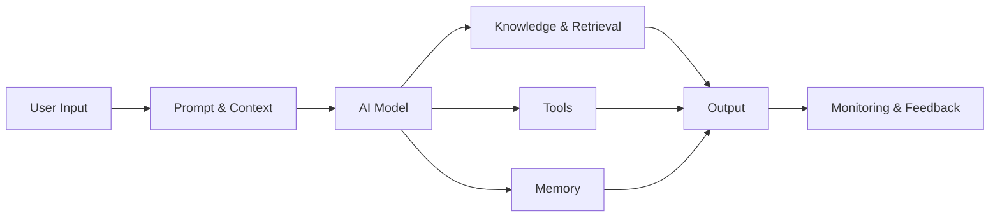
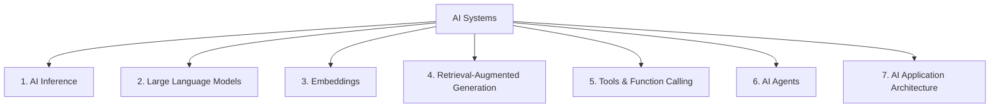

# AI Systems

## Tujuan

Memahami bagaimana sebuah model AI dikembangkan menjadi sistem yang dapat menerima input, menggunakan konteks dan pengetahuan, berinteraksi dengan tools, serta menghasilkan output yang dapat digunakan dalam aplikasi nyata.

Pada bagian ini, kalian tidak hanya mempelajari model AI, tetapi juga berbagai komponen di sekitarnya yang bekerja sebagai sebuah sistem, seperti data, knowledge, tools, dan feedback. 

## Apa Itu AI System?

AI System adalah sebuah sistem yang menggunakan teknologi AI untuk memproses data, membuat keputusan, dan memberikan output yang berguna dalam aplikasi nyata. Sebuah AI System dapat melibatkan:

- Model
- Input
- Prompt dan Context
- Knowledge
- Retrieval
- Tools
- Memory
- Monitoring dan Feedback

Secara sederhana dapat digambarkan melalui diagram berikut:

Tujuan AI Systems adalah memahami bagaimana komponen-komponen tersebut dapat digabungkan untuk menghasilkan sistem yang lebih berguna daripada model yang berdiri sendiri.

## Capaian Belajar

Setelah menyelesaikan materi ini, kalian diharapkan mampu:

- Memahami perbedaan antara AI model dan AI system.
- Memahami konsep inference dalam aplikasi AI.
- Memahami peran prompt, context, dan knowledge.
- Menjelaskan konsep embedding dan semantic search.
- Memahami konsep Retrieval-Augmented Generation (RAG).
- Memahami cara AI berinteraksi dengan tools dan external systems.
- Memahami konsep AI agent dan agentic workflow.
- Memahami peran orchestration dalam AI system.
- Merancang arsitektur AI sederhana untuk sebuah aplikasi.
- Menghubungkan AI system dengan aplikasi atau perangkat IoT.

## Peta Pembelajaran

