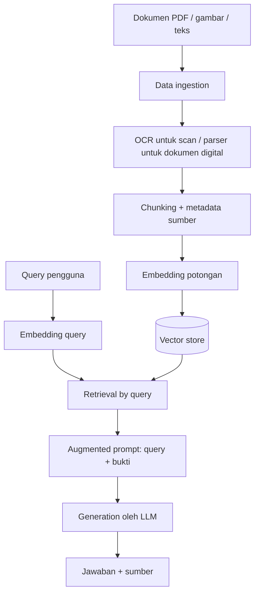
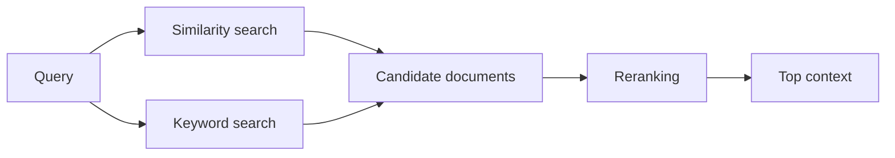

# Retrieval-Augmented Generation

RAG (*Retrieval-Augmented Generation*) mencari potongan dokumen yang relevan, lalu menyertakannya bersama query saat meminta model menyusun jawaban. Ini memberi model konteks dari dokumen yang dipilih aplikasi.

Alur RAG punya dua bagian: **indexing** menyiapkan dokumen sebelum query masuk; **retrieval dan generation** mencari konteks dan membuat jawaban saat query diterima.

## RAG Pipeline

Pipeline dari RAG dapat digambarkan sebagai berikut:



Klik [Interactive RAG Workflow](rag-tour.md) untuk memeriksa node, input, dan output, lalu jalankan alur langkah demi langkah atau otomatis.

Pada tahap indexing, OCR atau parser mengambil teks dan metadata. Teks dipecah menjadi chunk, diubah menjadi embedding, lalu disimpan dalam vector store seperti FAISS, Milvus, ChromaDB, Qdrant, atau PostgreSQL + pgvector.

## Retrieval

Retrieval memilih potongan yang berkaitan dengan query. Pencarian dapat memakai kemiripan embedding, kata kunci, atau gabungan keduanya; hasilnya dapat diurutkan ulang (*reranking*).



Kualitas hasil dipengaruhi oleh ukuran chunk, model embedding, dan cara pencarian. Uji pilihan tersebut pada query dan dokumen yang mewakili penggunaan sebenarnya. Teknik seperti hybrid search, reranking, atau HyDE dapat membantu pada kasus tertentu; ukur hasilnya sebelum menambahkannya.

## Augmentation

Augmentation menggabungkan instruksi, konteks terambil, dan query menjadi satu prompt. Contoh:

```text
Kamu adalah Nexo yang membantu user menjawab pertanyaan. Kamu memiliki beberapa ketentuan dalam menjawab pertanyaan, yaitu:
1. Jawaban harus berdasarkan konteks yang diberikan.
2. Jawaban harus jelas, ringkas, dan mudah dipahami.
3. **JAWABAN HARUS MENYERTAKAN SUMBER/SITASI DARI KONTEKS YANG DIBERIKAN**
4. Jika konteks tidak cukup, jawab dengan jujur bahwa kamu tidak tahu.
Berikut adalah konteks yang relevan dengan pertanyaan user:
[Hasil retrieval]

Pertanyaan user: [Query user]
```

## Generation

Pada generation, LLM menyusun jawaban dari prompt augmented. Kualitas jawaban dipengaruhi oleh:

- Instruksi yang menjelaskan cara memakai konteks dan apa yang harus dilakukan jika bukti kurang.
- Model yang sesuai dengan batas biaya, latensi, dan panjang konteks aplikasi.
- Parameter generasi seperti batas panjang keluaran dan temperature.


Lanjutkan dengan praktik berikut:

- [RAG sederhana](../../hands-on/rag-simple.md)
- [RAG lanjutan dengan HyDE + Browse Tool](../../hands-on/rag-advanced.md)
