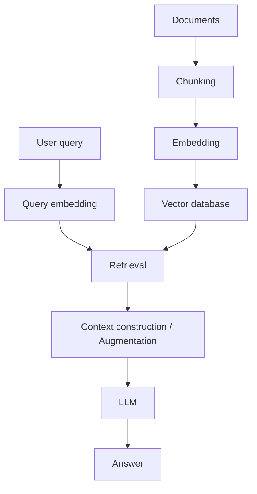
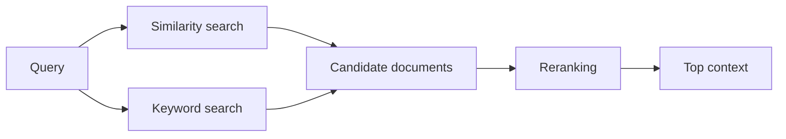

# Retrieval-Augmented Generation

Salah satu tantangan dalam penggunaan model generatif seperti Large Language Model (LLM) adalah **hallucination**, yaitu ketika model menghasilkan informasi yang tidak akurat, tidak didukung oleh sumber yang tersedia, atau bahkan tidak benar, tetapi disampaikan seolah-olah benar.

LLM menghasilkan respons berdasarkan pola yang dipelajari selama proses training. Model tidak memiliki mekanisme bawaan yang menjamin bahwa setiap informasi yang dihasilkan selalu benar atau telah terverifikasi. Selain itu, pengetahuan model memiliki **knowledge cut-off**, yaitu batas waktu data yang tersedia dalam proses training. Akibatnya, LLM dapat tidak mengetahui informasi yang muncul setelah periode training maupun menghasilkan informasi yang tidak akurat dari pengetahuan yang telah dipelajarinya.

Salah satu teknik yang dapat digunakan untuk memberikan informasi eksternal yang relevan kepada LLM adalah **RAG (Retrieval Augmented Generation)**. RAG menggabungkan proses pencarian informasi dari sumber eksternal dengan proses generasi jawaban oleh LLM.

Secara umum, RAG terdiri dari tiga tahap utama:

* **Retrieval**: mengambil informasi yang relevan dari knowledge base berdasarkan pertanyaan atau query pengguna.
* **Augmented**: menggabungkan informasi yang diperoleh dari retrieval dengan query pengguna menjadi konteks yang diberikan kepada LLM.
* **Generation**: LLM menghasilkan jawaban berdasarkan konteks yang telah diberikan.

Dengan pendekatan tersebut, LLM dapat menggunakan informasi dari knowledge base pada saat inference, sehingga jawaban dapat didasarkan pada sumber yang lebih spesifik dan relevan terhadap pertanyaan pengguna.

## RAG Pipeline

Pipeline dari RAG dapat digambarkan sebagai berikut:



Alur awal dari pengembangan sistem RAG adalah menyiapkan dokumen-dokumen yang akan digunakan sebagai knowledge base (pengetahuan tambahan) untuk model. Dokumen-dokumen ini dapat berupa artikel web, dokumen internal, atau sumber lain yang relevan. Jenis dokumen ini tidak hanya berupa teks, tetapi juga dapat berupa gambar, audio, atau video. Setelah dokumen dikumpulkan maka akan dilakukan ektraksi konten dan metadata yang kemudian akan dipecah menjadi potongan-potongan kecil (chunking) agar dapat diproses lebih lanjut. Setiap potongan ini kemudian diubah menjadi representasi vektor (embedding) yang dapat digunakan untuk pencarian berbasis kesamaan (similarity search) berdasarkan prompt atau query yang diberikan. Potongan tersebut akan disimpan dalam `vector database` seperti FAISS, Milvus, ChromaDB, Qdrant, atau PostgresSQL + pgvector.

## Retrieval

Proses retrieval bertujuan untuk mengambil informasi yang relevan dari knowledge base berdasarkan query pengguna. Proses ini dapat dilakukan dengan beberapa metode, yaitu similarity search yang mencari berdasarkan semantik kalimat dan keyword search berdasarkan frekuensi kata yang muncul.



Retrieval bisa dibilang sebagai tahapan yang paling penting dan banyak menghabiskan waktu. Banyak aspek yang dapat diperhatikan untuk menghasilkan `retrieval` yang bagus. Beberapa hal yang perlu diperhatikan antara lain:

- Ukuran chunk: Potongan dokumen yang terlalu besar dapat mengurangi relevansi informasi yang diambil, sedangkan potongan yang terlalu kecil dapat membuat konteks menjadi tidak lengkap. Ukuran chunk yang optimal biasanya berkisar antara 100 hingga 500 token, tergantung pada jenis dokumen dan kebutuhan aplikasi.
- Model Embedding: Pemilihan model embedding yang bagus dapat meningkatkan kualitas retrieval. Semakin baik sebuah model embedding dapat memahami sebuah konteks, semakin relevan hasil retrieval yang dihasilkan.
- Metode Retrieval: Penggunaan metode pencarian berbasis kemiripan (similarity search) belum tentu cukup untuk menghasilkan retrieval yang baik. Biasanya menggunakan kombinasi dengan keyword search, reranking, hingga penerapan HyDE (Hypothetical Document Embeddings) dapat meningkatkan kualitas retrieval.

## Augmentation

Ketika sudah melewati fase Retrieval, maka hasil retrieval akan digunakan untuk membangun konteks yang akan diberikan kepada LLM. Proses ini disebut sebagai augmentation. Fase ini cukup sederhana, yaitu menggabungkan query pengguna dengan hasil retrieval yang kemudian dikirimkan ke model. Contoh:

```text
Kamu adalah Nexo yang membantu user menjawab pertanyaan. Kamu memiliki beberapa ketentuan dalam menjawab pertanyaan, yaitu:
1. Jawaban harus berdasarkan konteks yang diberikan.
2. Jawaban harus jelas, ringkas, dan mudah dipahami.
3. **JAWABAN HARUS MENYERTAKAN SUMBER/SITASI DARI KONTEKS YANG DIBERIKAN**
4. Jika konteks tidak cukup, jawab dengan jujur bahwa kamu tidak tahu.
Berikut adalah konteks yang relevan dengan pertanyaan user:
[Hasil retrieval]

Pertanyaan user: [Query user]
```

## Generation

Tahap terakhir adalah proses generation, yaitu LLM menghasilkan jawaban berdasarkan konteks yang diberikan. Pada tahap ini, LLM akan memproses query pengguna dan konteks yang telah dibangun pada tahap augmentation untuk menghasilkan jawaban yang relevan dan akurat. Tentu ada beberapa aspek yang dapat diperhatikan pada tahap ini, antara lain:

- Prompting: Prompt yang diberikan kepada LLM harus jelas dan spesifik agar model dapat memahami konteks dan menghasilkan jawaban yang sesuai. Prompt yang ambigu atau terlalu umum dapat menyebabkan model menghasilkan jawaban yang tidak relevan atau tidak akurat.
- Model Selection: Pemilihan model LLM yang tepat juga dapat mempengaruhi kualitas jawaban yang dihasilkan. Model yang lebih besar dan lebih pintar biasanya memiliki kemampuan pemahaman konteks yang lebih baik, tetapi juga membutuhkan sumber daya komputasi yang lebih besar.
- Parameter Tuning: Beberapa model LLM memiliki parameter yang dapat disesuaikan untuk mengontrol kualitas jawaban yang dihasilkan. Parameter ini dapat mencakup panjang jawaban, tingkat kreativitas, dan tingkat kepercayaan model terhadap jawaban yang dihasilkan (temperature, top_p, dll).


Untuk lebih memperdalam pemahaman soal RAG, dapat mengunjungi halaman hands-on:

- [RAG sederhana](../../hands-on/rag-simple.md)
- [RAG lanjutan dengan HyDE + Browse Tool](../../hands-on/rag-advanced.md)