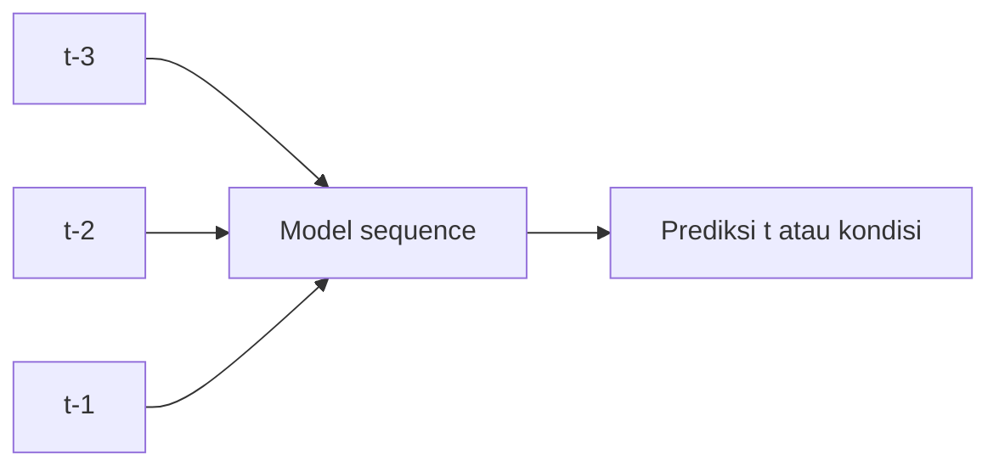

# Model Sequence untuk Deret Waktu

Model sequence digunakan ketika urutan data membawa informasi. Pada sistem AIoT, urutan suhu, kelembapan, getaran, atau arus listrik dapat membantu model membedakan tren normal dari perubahan yang tidak biasa.

## Windowing

Data diubah menjadi window yang berisi beberapa pengamatan sebelumnya. Jika panjang window adalah `T` dan setiap pengamatan memiliki `F` fitur, bentuk input dapat ditulis sebagai:

$$
X \in \mathbb{R}^{T \times F}
$$

Target dapat berupa nilai berikutnya, kelas seluruh window, atau beberapa nilai pada masa depan.

Contoh baseline: dua suhu terakhir `[29.0, 29.5]` menghasilkan moving average `29.25 °C`. Baseline nilai terakhir menghasilkan `29.5 °C`. Jika suhu aktual berikutnya `30.0 °C`, error absolutnya masing-masing `0.75 °C` dan `0.5 °C`. Satu sampel belum cukup untuk memilih model; perbandingan dilakukan pada seluruh periode uji.

## RNN, LSTM, dan GRU

RNN memproses input secara berurutan dan membawa hidden state dari langkah sebelumnya. LSTM dan GRU menambahkan mekanisme gate agar informasi penting dapat dipertahankan lebih lama.

- RNN cocok sebagai pengantar konsep state.
- LSTM memiliki cell state dan beberapa gate, tetapi lebih besar dan lebih lambat.
- GRU memiliki struktur yang lebih ringkas dan sering menjadi alternatif LSTM.
- CNN 1D dapat lebih ringan jika pola lokal sudah cukup.

## Evaluasi Berbasis Waktu

Jangan mencampur pengamatan masa depan ke data training. Urutkan data berdasarkan timestamp, gunakan bagian awal untuk training, bagian berikutnya untuk validation, dan bagian terakhir untuk test.

## Kasus AIoT

- Prediksi suhu satu langkah ke depan.
- Klasifikasi kondisi pompa dari getaran.
- Deteksi perubahan pola kelembapan tanah.
- Prediksi kebutuhan air berdasarkan riwayat sensor dan cuaca.

LSTM tidak menjadi pilihan pertama hanya karena data memiliki timestamp. Bandingkan dengan baseline seperti nilai terakhir, moving average, atau model berbasis fitur.

[Kembali ke Deep Learning](overview.md)
