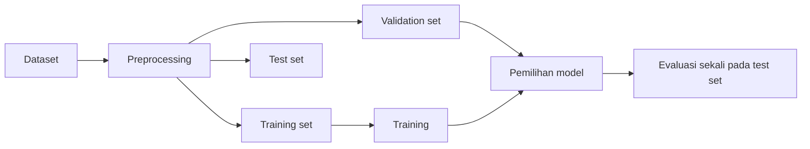

# Optimasi dan Training

Training mencari parameter model yang menghasilkan loss kecil pada data training dan tetap bekerja pada data baru. Proses ini harus dipantau karena loss training yang rendah dapat terjadi bersamaan dengan performa validation yang buruk.



## Hyperparameter Utama

- **Batch size** menentukan jumlah contoh yang diproses sebelum update parameter.
- **Epoch** menentukan berapa kali model melihat seluruh data training.
- **Learning rate** menentukan besar perubahan parameter.
- **Optimizer** menentukan aturan update, misalnya SGD atau Adam.
- **Model capacity** ditentukan oleh jumlah layer dan neuron.

## Overfitting dan Underfitting

Underfitting terjadi ketika model belum mampu mempelajari pola. Overfitting terjadi ketika model terlalu mengikuti data training dan gagal pada data baru.

```text
training loss turun + validation loss turun     -> training masih membantu
training loss turun + validation loss naik       -> kemungkinan overfitting
keduanya tetap tinggi                             -> kemungkinan underfitting
```

Gunakan dropout, weight decay, data augmentation, early stopping, atau model yang lebih kecil sesuai penyebabnya.

## Evaluasi Data Sensor

Untuk data yang memiliki urutan waktu, pembagian acak dapat menyebabkan data masa depan masuk ke training. Gunakan pembagian berdasarkan waktu jika tujuan model adalah memprediksi masa depan.

## Metrik

- Regresi: MAE, RMSE, dan error maksimum.
- Klasifikasi: accuracy, precision, recall, F1 score, dan confusion matrix.
- Anomali: false alarm rate, missed anomaly, dan detection delay.
- Deployment: waktu inference, RAM, ukuran model, dan konsumsi daya.

[Kembali ke Deep Learning](overview.md)
