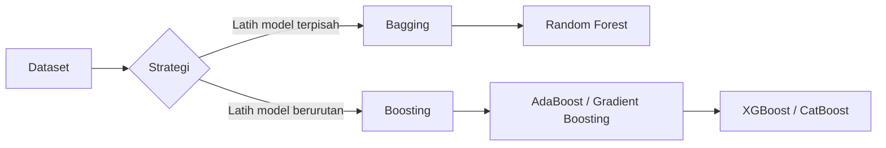
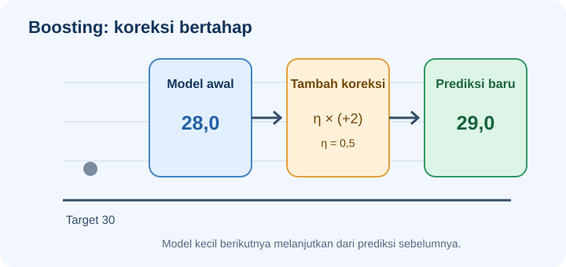

# Ensemble Learning

Ensemble menggabungkan prediksi dari beberapa model. Tujuannya mengurangi ketidakstabilan atau memperbaiki kesalahan yang masih dibuat model sebelumnya. Random Forest memakai bagging; AdaBoost, Gradient Boosting, XGBoost, dan CatBoost termasuk boosting.

## Decision tree sebagai model dasar

Sebuah tree membagi data lewat pertanyaan tentang fitur. Pada regresi, daun biasanya mengeluarkan rata-rata target di dalamnya; pada klasifikasi, daun mengeluarkan kelas mayoritas atau probabilitas kelas. Tree kecil mudah dibaca, sedangkan tree yang dalam dapat mengikuti noise pada data training.

## Bagging dan Random Forest

Bagging membuat beberapa sampel bootstrap dengan mengambil baris data secara acak dan mengizinkan baris yang sama terpilih lebih dari sekali. Setiap model dilatih sendiri. Untuk regresi, prediksi digabungkan dengan rata-rata:

$$
\hat{f}_{bag}(x) = \frac{1}{M}\sum_{m=1}^{M}\hat{f}_m(x)
$$

Jika tiga tree memprediksi `28, 30, 32 °C`, hasil bagging adalah `(28+30+32)/3 = 30 °C`. Untuk klasifikasi, model dapat memakai suara mayoritas.

Random Forest menambah pengacakan fitur: setiap tree hanya mempertimbangkan subset fitur pada tiap pemisahan. Tree yang berbeda cenderung membuat kesalahan berbeda; merata-ratakannya mengurangi variance dan membuat prediksi lebih stabil.

## Boosting

Boosting membangun model berurutan. Model berikutnya diarahkan untuk memperbaiki kesalahan gabungan model sebelumnya. Bentuk sederhana untuk regresi adalah:

$$
F_m(x) = F_{m-1}(x) + \eta h_m(x)
$$

`F_{m-1}` adalah prediksi saat ini, `h_m` model baru, dan `η` learning rate yang mengecilkan kontribusi model baru. Contoh: prediksi awal `28 °C`, model berikutnya memperkirakan koreksi `+2 °C`, dan `η=0,1`; prediksi berubah menjadi `28 + 0,1(2) = 28,2 °C`. Banyak langkah kecil dapat memperbaiki prediksi tanpa memberi satu tree pengaruh terlalu besar.

Jika tree terlalu dalam atau jumlah langkah terlalu banyak, boosting dapat overfit. Learning rate yang lebih kecil biasanya memerlukan lebih banyak tree. Early stopping menghentikan training saat skor validation tidak lagi membaik.

## XGBoost dan CatBoost

XGBoost mengoptimalkan gradient boosted trees dengan regularisasi dan teknik komputasi untuk data tabular. Parameter yang sering diperiksa meliputi kedalaman tree, learning rate, jumlah tree, subsampling, dan regularisasi.

CatBoost juga memakai gradient boosting dan menyediakan penanganan fitur kategorikal. Fitur seperti jenis perangkat, lokasi greenhouse, atau mode operasi dapat dimasukkan sebagai kategori; pemisahan data tetap harus mencegah informasi target bocor ke training.

Keduanya bukan jaminan hasil lebih baik. Mulai dari baseline atau Random Forest, lalu bandingkan pada split waktu dan metrik yang sama. Periksa juga latensi dan ukuran model jika inference berjalan di gateway.

## Memilih strategi

Bagging cocok ketika satu model seperti decision tree berubah banyak akibat perubahan data latih. Boosting cocok saat ingin memperbaiki kesalahan secara bertahap dan tersedia waktu untuk menyetel parameter. Periksa skor train dan validation; skor train yang terus naik sementara validation memburuk adalah tanda overfitting.

[Kembali ke Machine Learning](overview.md)
