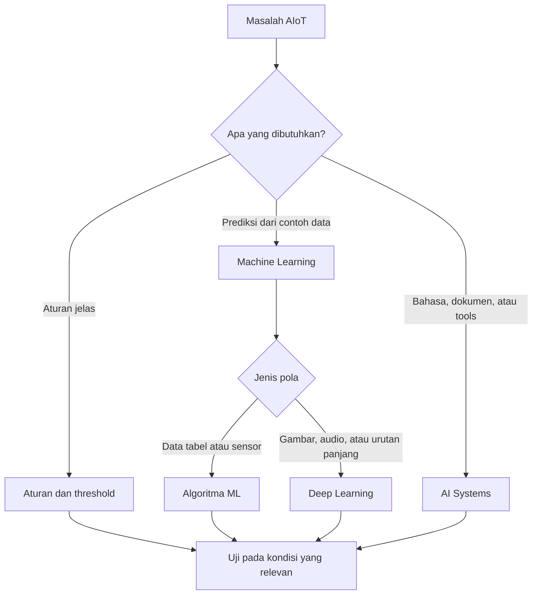

# Artificial Intelligence

AI adalah bidang yang mempelajari cara membuat sistem menyelesaikan tugas seperti mengenali pola, memprediksi nilai, memahami bahasa, dan memilih tindakan. Dalam AIoT, pilih pendekatan dari masalah dan data yang tersedia. Model yang lebih rumit tidak otomatis memberi hasil yang lebih baik.

Aturan sederhana cocok jika keputusan dapat ditulis dan diperiksa langsung. Machine Learning mempelajari pola dari contoh data. Deep Learning adalah bagian dari Machine Learning yang memakai jaringan saraf berlapis; pendekatan ini sering dipakai untuk gambar, audio, dan pola berurutan. AI Systems menggabungkan model dengan komponen seperti prompt, retrieval, dan tools. AI Systems dapat memakai model yang sudah tersedia, jadi kamu tidak harus melatih model sendiri lebih dulu.

## Rute belajar

- Mulai dari [AI Fundamental](fundamental.md) untuk merumuskan masalah sensor, mencoba aturan pembanding, dan memahami kapan model mungkin membantu.
- Buka [Machine Learning](machine-learning/overview.md) untuk menyiapkan data, mempelajari algoritma, dan mengevaluasi prediksi.
- Lanjutkan ke [Deep Learning](deep-learning/overview.md) setelah mengenal data dan evaluasi model. Materi ini membahas jaringan saraf serta penerapannya pada data sensor, gambar, dan urutan.
- Pilih [AI Systems](ai-systems/overview.md) jika ingin memahami inference, LLM, embeddings, RAG, tools, MCP, dan agents sebagai bagian dari aplikasi.
- Lanjutkan ke [AI Dashboard](ai-dashboard/overview.md) untuk membuat antarmuka Python bagi data, model, dan demo AI dengan Streamlit atau Gradio.

Data sensor yang dipakai untuk latihan disimpan dan diolah lewat database. Lihat [Overview Database](../database/overview.md) untuk alur dari device dan backend sampai query yang dapat digunakan dashboard atau analisis.

Untuk contoh tangki air, [AI Fundamental](fundamental.md) memulai dari aturan alarm sederhana. Jika targetnya memprediksi kapan air akan melewati batas, lanjut ke [Masalah dan Data](machine-learning/masalah-dan-data.md) untuk menentukan input, target, dan waktu prediksi.

[Buka Sumber Eksplorasi AI](sumber-eksplorasi.md){ .md-button }

[Kembali ke Home](../index.md)
