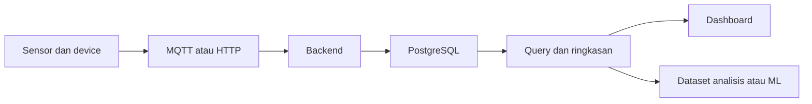

# Database

Bagian ini memakai PostgreSQL untuk menyimpan data perangkat, pembacaan sensor, dan riwayat sistem. Kamu akan mulai dari konsep tabel dan SQL, lalu merancang data sensor. Setelah itu, materi UUID menjelaskan ID yang dipakai KSM AIoT, dan Time-Series memperkenalkan TimescaleDB untuk mengelola data berdasarkan waktu.

## Alur data

Database menyimpan data agar backend dan dashboard dapat membaca catatan yang sama. PostgreSQL dipilih untuk materi ini karena menyimpan data relasional dengan SQL, transaksi, dan constraint. Hubungan seperti device–sensor–pembacaan dapat dijelaskan dalam satu sistem; bila kebutuhan time-series tumbuh, TimescaleDB menambahkan fitur khusus tanpa mengganti cara dasar memakai tabel PostgreSQL.

## Urutan belajar

1. [Database Fundamental](fundamental.md) — tabel, tipe data, kunci, dan relasi.
2. [SQL Basics](sql-basics.md) — instalasi PostgreSQL, membuat tabel, dan menjalankan query.
3. [Desain Data IoT](data-modeling.md) — memisahkan perangkat dan pembacaan sensor.
4. [UUIDv4 dan UUIDv7](uuid-identifiers.md) — memilih ID sesuai kebutuhan dan konvensi KSM AIoT.
5. [Time-Series dan TimescaleDB](timeseries.md) — hypertable, columnstore, ringkasan, dan retensi data.
6. [Database Mini](../hands-on/database-mini.md) — menyimpan dan membaca pembacaan sensor.

## Setelah bagian ini

Kamu akan bisa membaca struktur tabel, menulis query untuk sensor, dan menjelaskan kapan PostgreSQL biasa cukup serta kapan TimescaleDB membantu. Data historis yang dibaca dengan query juga dapat menjadi sumber fitur untuk [Machine Learning](../ai/machine-learning/overview.md). Untuk alur kirim data dari backend sampai dashboard, lanjutkan ke [Dashboard Hands-on](../hands-on/dashboard-hands-on.md).

[Kembali ke Home](../index.md)
