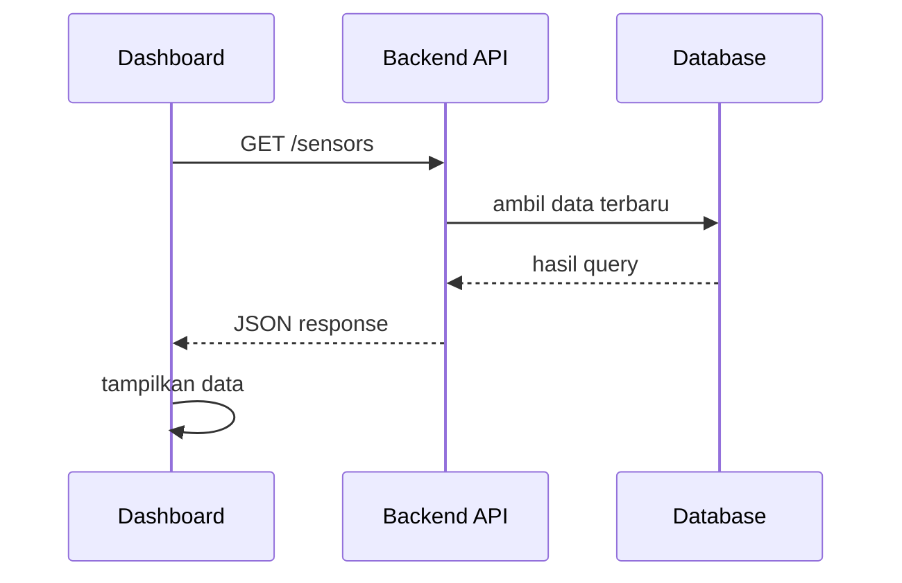

# Integrasi Frontend dengan API

Dashboard tidak hidup sendirian.

Ia perlu mengambil data dari backend. Proses ini disebut integrasi API.

## Alur Dasar



## Hal yang Perlu Disiapkan

Sebelum frontend memanggil API, pastikan:

- backend sedang berjalan,
- endpoint benar,
- response berbentuk JSON,
- CORS sudah diizinkan jika frontend dan backend beda port.

## Fetch Data

Contoh sederhana:

```js
const response = await fetch("http://127.0.0.1:8000/sensors");
const sensors = await response.json();
```

Setelah [Dashboard Hands-on](../hands-on/dashboard-hands-on.md), endpoint `GET /sensors` mengembalikan array pembacaan terbaru. Fetch mengubah response JSON menjadi array JavaScript.

## Loading, Error, dan Empty

Integrasi API tidak selalu sukses.

Karena itu UI perlu menyiapkan beberapa kondisi:

```text
mulai request -> loading
request sukses + data ada -> tampilkan data
request sukses + data kosong -> tampilkan empty state
request gagal -> tampilkan error
```

## CORS

CORS adalah aturan keamanan browser.

Kalau frontend berjalan di `127.0.0.1:5500` dan backend berjalan di `127.0.0.1:8000`, browser menganggap keduanya berbeda asal.

Jika backend belum mengizinkan frontend, browser bisa menolak request.

## Lacak klik sampai pesan tampil

Gunakan tombol **Cek Backend** pada [Frontend Mini](../hands-on/frontend-mini.md). Klik memanggil `loadHealth()`, lalu fungsi menjalankan `fetch` ke `http://127.0.0.1:8000/health`.

Coba dua keadaan berikut:

| Keadaan | Yang terlihat di elemen `output` |
| --- | --- |
| Backend Mini berjalan | `{"status":"ok"}` setelah request selesai |
| Backend tidak berjalan atau alamat tidak bisa dijangkau | `Gagal mengambil data dari backend.` |

Saat request dimulai, teks berubah menjadi `Mengambil data...`. Contoh ini memeriksa `response.ok`. Sambungan yang gagal dan kode HTTP gagal seperti `404` berakhir di blok `catch`.

[Kembali ke Overview Frontend](overview.md)
