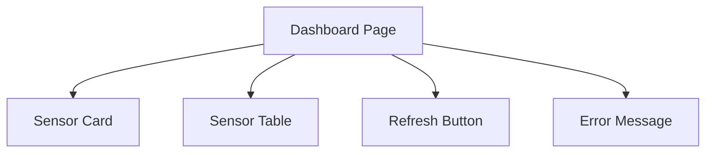

# Vue Basics

Vue membantu kita membangun frontend dari potongan kecil bernama **component**.

Component bisa dianggap seperti bagian dashboard yang punya tugas sendiri: kartu sensor, tabel data, tombol refresh, atau panel status device.

## Kenapa Pakai Component?

Kalau dashboard makin besar, satu file akan sulit dirawat.

Dengan component, kita bisa memecah tampilan menjadi bagian kecil.



## Data Reaktif

Di Vue, data yang berubah bisa otomatis memperbarui tampilan.

Contoh ide sederhananya:

```text
data berubah -> Vue memperbarui UI
```

Karena itu Vue cocok untuk dashboard yang datanya sering berubah.

## Props

Props adalah data yang dikirim dari component induk ke component anak.

Misalnya halaman dashboard punya data sensor, lalu mengirim satu item sensor ke `SensorCard`.

```text
Dashboard -> SensorCard
```

## Event

Event adalah sinyal dari component anak ke component induk.

Contoh:

```text
RefreshButton diklik -> Dashboard mengambil data lagi
```

## Lifecycle

Lifecycle adalah momen ketika component dibuat, muncul di halaman, diperbarui, atau dihapus.

Untuk pemula, cukup ingat satu pola:

> Saat halaman dibuka, ambil data awal dari backend.

## Ikuti data halaman ke prop komponen

Repo materi ini belum menyertakan aplikasi Vue untuk ditelusuri. Gunakan contoh mini berikut untuk melihat satu nilai diteruskan dari halaman ke komponen.

`Dashboard.vue`:

```vue
<script setup lang="ts">
import SensorCard from "./SensorCard.vue";

const reading = { deviceId: "esp32-01", value: 28.5 };
</script>

<template>
  <SensorCard :device-id="reading.deviceId" :value="reading.value" />
</template>
```

`SensorCard.vue`:

```vue
<script setup lang="ts">
defineProps<{ deviceId: string; value: number }>();
</script>

<template>
  <p>{{ deviceId }}: {{ value }} °C</p>
</template>
```

Ikuti `reading.value` dari halaman ke prop `value`; komponen menampilkannya sebagai `28.5 °C`. Atribut `:device-id` diterima sebagai prop `deviceId`.

[Kembali ke Overview Frontend](overview.md)
