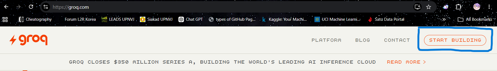
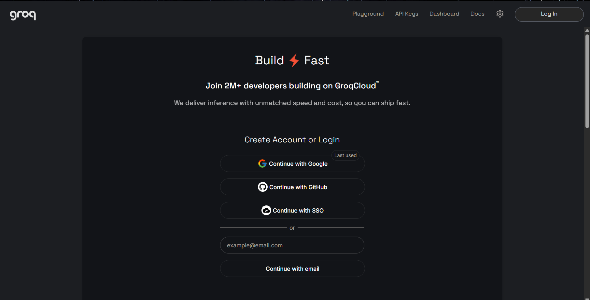
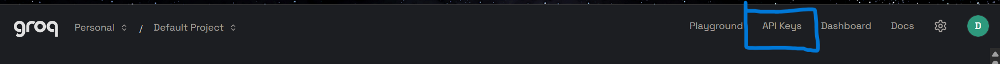
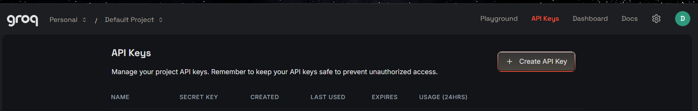

# Hands-on Pengembangan RAG Sederhana

Pada hands-on ini, kita akan membuat sistem RAG sederhana yang dapat menjawab pertanyaan pengguna berdasarkan knowledge base yang telah disiapkan. Sistem ini akan menggunakan LLM untuk menghasilkan jawaban berdasarkan konteks yang diberikan. Meskipun pada contoh ini menggunakan 1 dokumen dan LLM lokal, prinsip yang sama dapat diterapkan pada sistem RAG yang lebih kompleks dengan banyak dokumen dan LLM eksternal.

!!! info

    Kalian diperbolehkan untuk menambahkan dokumen lain, menyesuaikan prompt, atau mengubah LLM yang digunakan. Selamat eksplorasi!

Beberapa model yang digunakan adalah:

- LLM: `gpt-oss-120b` via groq atau `Gemma 4 E2B QAT` via llama server di device masing-masing (sesuaikan dengan kemampuan device kalian).
- Embedding: `sentence-transformers/paraphrase-multilingual-mpnet-base-v2` via SentenceTransformers

Tahapan pada hands-on ini akan mengikuti alur RAG yang telah dijelaskan pada [RAG Pipeline](../../ai/ai-systems/rag.md#rag-pipeline). Berikut adalah tahapan-tahapan yang akan dilakukan:

- Text Extraction: Mengekstrak konten dari dokumen yang telah disiapkan.
- Chunking: Memecah konten dokumen menjadi potongan-potongan kecil (chunk) agar dapat diproses lebih lanjut.
- Embedding: Mengubah potongan-potongan dokumen menjadi representasi vektor (embedding) yang dapat digunakan untuk pencarian berbasis kesamaan (similarity search).
- Vector Database: Menyimpan embedding ke dalam database vektor seperti FAISS, Milvus, ChromaDB, Qdrant, atau PostgresSQL + pgvector.
- Retrieval: Mengambil informasi yang relevan dari knowledge base berdasarkan query pengguna.
- Augmentation: Menggabungkan query pengguna dengan hasil retrieval untuk membangun konteks yang akan diberikan kepada LLM.
- Generation: LLM menghasilkan jawaban berdasarkan konteks yang diberikan.

Cekidot!

## Instalasi Library

```bash
uv pip install docling sentence-transformers openai groq pymupdf chromadb -q
```

Penjelasannya:

- `docling`: Library untuk mengekstrak konten dari dokumen.
- `sentence-transformers`: Library untuk membuat embedding dari potongan-potongan dokumen.
- `openai`: Library untuk berinteraksi dengan LLM.
- `groq`: Library untuk berinteraksi dengan LLM Groq.
- `pymupdf`: Library untuk membaca file PDF.
- `chromadb`: Library untuk mengelola database vektor.

Mengapa kita menggunakan `docling` dan `pymupdf`? pada modul ini kita akan melihat perbedaan dari 2 tipe ekstraktor.

## Text Extraction

Text extraction merupakan tahap awal dalam penyediaan data untuk knowledge base LLM. Tahap ini bertujuan mengambil teks atau informasi terstruktur dari berbagai sumber, seperti PDF, dokumen, gambar, audio, video, maupun halaman web.

Beberapa pendekatan yang umum digunakan dalam text extraction antara lain:

- **Parsing**: mengekstrak teks atau data secara langsung dari struktur internal suatu file atau dokumen, seperti PDF text-based, HTML, DOCX, JSON, dan Markdown.
- **OCR (Optical Character Recognition)**: mengenali teks yang terdapat di dalam gambar atau dokumen hasil pemindaian dan mengubahnya menjadi teks digital yang dapat diproses lebih lanjut.
- **AI-Based Extraction**: menggunakan model AI untuk memahami dokumen secara lebih mendalam, termasuk layout, struktur, tabel, hubungan antar-elemen, dan konteks informasi yang terdapat di dalam dokumen.

Atur sumber dokumen:

```python
import os
from pathlib import Path

# Atur path ke direktori dokumen
doc_path = Path("path/to/your/documents")
```

Untuk dokumennya dapat kalian unduh dari [sini](https://drive.google.com/file/d/1SkcgeaFHAH71_YDsgkgw0CyFzVgjPKzC/view?usp=sharing)

### Text Extraction dengan PyMuPDF

[PyMuPDF](https://pymupdf.readthedocs.io/en/latest/index.html) merupakan salah satu tools parsing PDF yang ringan dan cepat. Adapun versi ekstraksi untuk LLM yaitu PyMuPDF4LLM.

Membaca file pdf dan cetak total halaman.

```python
import pymupdf

doc = pymupdf.open(doc_path)
print(f"Total Halaman: {len(doc)}\n")
```

Ekstrak langsung:

```python
print("--- [METODE 1: Plain Text Extraction] ---")
for page_num in range(len(doc)):
    page = doc[page_num]
    text = page.get_text("text")
    print(f"=== HALAMAN {page_num + 1} ===")
    print(text[:300] + "...\n")  # Tampilkan 300 karakter pertama
```

Ekstrak per blok teks:

```python
print("--- [METODE 2: Block Text Extraction] ---")
page_1 = doc[0]
blocks = page_1.get_text("blocks")

for i, block in enumerate(blocks):
    # block format: (x0, y0, x1, y1, text, block_no, block_type)
    block_text = block[4].strip()
    block_type = block[6]  # 0 = Teks, 1 = Gambar

    if block_type == 0 and block_text:
        print(f"[Block {i}] (y0: {block[1]:.1f}):")
        print(f"  {block_text[:100]}...\n")
```

Ekstrak tabel:

```python
print("--- [METODE 3: Table Extraction] ---")
for page_num in range(len(doc)):
    page = doc[page_num]
    tabs = page.find_tables()  # Deteksi tabel pada halaman

    if tabs.tables:
        print(f"Ditemukan {len(tabs.tables)} tabel di Halaman {page_num + 1}:")
        for t_idx, table in enumerate(tabs.tables):
            # Konversi tabel ke Pandas DataFrame
            df = table.to_pandas()
            print(f"\n[Tabel {t_idx + 1} Halaman {page_num + 1}]")
            print(df.to_string())

            # Bisa juga diubah langsung ke Markdown untuk RAG Chunk
            print("\nFormat Markdown:")
            print(df.to_markdown(index=False))
            print("-" * 50)

doc.close()
```

### Text Extraction dengan Docling

[Docling](https://docling-project.github.io/docling/) merupakan document processing toolkit yang dapat melakukan document parsing, OCR, dan structural document understanding untuk mengubah berbagai format dokumen menjadi representasi terstruktur yang dapat digunakan dalam pipeline seperti RAG.

```python
from docling.document_converter import DocumentConverter
import logging

converter = DocumentConverter()
doc = converter.convert(doc_path).document

print(doc.export_to_markdown())
```

Kalian bisa bandingkan hasilnya, Docling menghasilkan ekstraksi yang lebih rapi dan terstruktur dibandingkan PyMuPDF. Namun, Docling membutuhkan lebih banyak resource dan waktu untuk memproses dokumen ketimbang PyMuPDF.

## Chunking

Chunking merupakan proses membagi dokumen atau teks menjadi bagian-bagian yang lebih kecil yang disebut **chunk**. Proses ini dilakukan agar setiap bagian informasi dapat diproses, disimpan, dan diambil kembali (*retrieved*) oleh sistem seperti RAG secara lebih efektif.

Beberapa strategi chunking yang umum digunakan antara lain:

1. **Page-Based Chunking**
   Membagi dokumen berdasarkan halaman. Setiap halaman atau kelompok halaman menjadi satu chunk. Teknik ini sederhana dan dapat mempertahankan batas halaman dokumen, tetapi konteks suatu informasi dapat terputus apabila informasi tersebut tersebar di beberapa halaman.

2. **Hierarchy-Based Chunking**
   Membagi dokumen berdasarkan struktur dan hierarki informasinya, seperti heading, subheading, paragraf, dan bagian lainnya. Teknik ini dapat mempertahankan konteks dari struktur dokumen, misalnya informasi pada suatu paragraf tetap dikaitkan dengan heading atau subheading yang menaunginya.

3. **Token-Based Chunking**
   Membagi dokumen berdasarkan jumlah token tertentu. Teknik ini berguna untuk mengontrol ukuran input yang diberikan kepada embedding model maupun LLM. Namun, apabila digunakan tanpa mempertimbangkan struktur dokumen, suatu pembahasan dapat terpotong di tengah konteksnya.

Setiap strategi memiliki kelebihan dan kekurangan yang berbeda sehingga pemilihannya perlu disesuaikan dengan karakteristik dokumen dan kebutuhan sistem.

Untuk dokumen yang memiliki struktur yang jelas, **Hierarchy-Based Chunking dapat menjadi pilihan yang baik** karena struktur hierarki dapat digunakan sebagai bagian dari konteks chunk. Namun, teknik ini bukan selalu pilihan terbaik untuk semua kasus. Dalam praktiknya, beberapa strategi juga dapat **dikombinasikan**, misalnya menggunakan hierarchy-based chunking dengan batas maksimum token untuk menjaga konteks sekaligus mengontrol ukuran chunk.

Pada modul ini kita menggunakan **HybridChunking** yang telah disediakan oleh Docling. HybridChunking menggabungkan beberapa strategi chunking, seperti hierarchy-based dan token-based chunking, untuk menghasilkan potongan-potongan dokumen yang lebih optimal.

```python
from docling.chunking import HybridChunker

chunker = HybridChunker(max_tokens=96) # Set max_tokens sesuai kebutuhan kalian, mempengaruhi ukuran chunk yang dihasilkan
chunks = list(chunker.chunk(doc))

print(f"Total Chunks Dihasilkan: {len(chunks)}\n")

idx = 1
sample_chunk = chunks[idx]
print(f"=== CONTOH CHUNK {idx+1} ===")
print(f"Header: {sample_chunk.meta.headings}")
print(f"Teks Content:\n{sample_chunk.text}\n")
```

Output dari kode di atas akan menampilkan jumlah chunk yang dihasilkan dan contoh salah satu chunk beserta header dan teks kontennya. Keuntungan dari HybridChunking adalah metode ini menyertakan informasi header dari dokumen sebagai bagian dari metadata chunk, sehingga konteks dari setiap chunk dapat lebih mudah dipahami oleh LLM saat proses retrieval dan generation.

Untuk cetak semua chunk:

```python
for i, chunk in enumerate(chunks):
    print(f"=== CHUNK {i+1} ===")
    print(f"Header: {chunk.meta.headings}")
    print(f"Teks Content:\n{chunk.text}\n")
```

## Embedding dengan SentenceTransformers & Vector Database

entence Transformers merupakan salah satu library yang dapat digunakan untuk melakukan embedding pada teks. Embedding merupakan teknik mengubah teks menjadi sebuah vector N dimensi (bergantung pada model embedding yang digunakan). Setelah teks diembedding, maka dapat dilakukan pengukuran untuk mencari teks terdekat dari sebuah prompt.

Setelah teks diembedding maka disimpan ke database khusus yang dapat mendukung format vector. Beberapa database vector adalah sebagai berikut:

- FAISS
- ChromaDB
- QDrant
- ElasticSearch
- PostgreSQL + pgvector

Pada modul ini menggunakan ChromaDB. Selain untuk menyimpan data dalam bentuk vector, database tersebut juga bisa melakukan operasi pencarian dokumen berbasis kemiripan.

Menyiapkan model embedding:

```python
from sentence_transformers import SentenceTransformer, util

model = SentenceTransformer("sentence-transformers/paraphrase-multilingual-mpnet-base-v2")
```

Menyiapkan database vector dan custom embedding menyesuaikan model yang digunakan:

```python
import chromadb
from chromadb import EmbeddingFunction, Documents, Embeddings

# 1. Wrapper Custom Embedding Model
class MyCustomEmbeddingFunction(EmbeddingFunction):
    def __init__(self, st_model):
        self.model = st_model

    def __call__(self, input: Documents) -> Embeddings:
        # Menghasilkan vektor embedding dalam bentuk list Python
        return self.model.encode(input).tolist()

# 2. Inisialisasi ChromaDB
chroma_client = chromadb.PersistentClient(path="./chroma_db")

embedding_fn = MyCustomEmbeddingFunction(model)

collection = chroma_client.get_or_create_collection(
    name="nutrisi_hidroponik",
    embedding_function=embedding_fn,
    metadata={"hnsw:space": "cosine"}
)
```

Setelah database vector siap, kita dapat menyimpan chunk ke dalam database tersebut. Agar setiap chunk dapat diidentifikasi, kita dapat menambahkan metadata seperti `chunk_id`, `source`, dan `headings` dari dokumen.

```python
documents = []
metadatas = []
ids = []

for idx, chunk in enumerate(chunks):
    documents.append(chunk.text)
    # build metadata
    meta = {}
    meta["source"] = chunk.meta.origin.filename
    meta["headings"] = chunk.meta.headings
    meta["chunk_id"] = f"chunk_{idx}"
    metadatas.append(meta)
    ids.append(f"doc_chunk_{idx}")

# Simpan ke DB (otomatis melakukan embedding)
collection.add(
    documents=documents,
    metadatas=metadatas,
    ids=ids
)
```

Setelah chunk tersimpan, kita dapat masuk ke fase retrieval untuk mengambil informasi yang relevan dari knowledge base berdasarkan query pengguna.

## [Retrieval](../../ai/ai-systems/rag.md#retrieval)

```python
query_text = "tanaman pakcoy butuh target PH dan target PPM berapa"

results = collection.query(
    query_texts=[query_text],
    n_results=3 # Mengambil 3 hasil teratas dari database vector yang paling relevan dengan query
)

print(f"\n[QUERY]: {query_text}\n")
for i, (doc_text, meta) in enumerate(zip(results["documents"][0], results["metadatas"][0])):
    print(f"=== HASIL RETRIEVAL {i+1} ===")
    print(f"Metadata : {meta}")
    print(f"Isi Teks :\n{doc_text}\n")
```

Jika kalian ingin menampilkan nilai kemiripan (similarity score) kalian dapat menambahkan kode berikut:

```python
results = collection.query(
    query_texts=[query_text],
    n_results=5
)

for i, (doc, meta, distance) in enumerate(
    zip(
        results["documents"][0],
        results["metadatas"][0],
        results["distances"][0]
    )
):
    print(f"=== HASIL RETRIEVAL {i+1} ===")
    print(f"Distance : {distance:.4f}")
    print(f"Metadata : {meta}")
    print(f"Isi Teks :\n{doc}\n")
```

## [Augmentation](../../ai/ai-systems/rag.md#augmentation)

fase augmentation bertujuan untuk membangun konteks yang akan diberikan kepada LLM.

```python
SYSTEM_PROMPT = """Kamu adalah Nexo, Asisten Bot KSM AIoT.

Tugasmu adalah menjawab pertanyaan berdasarkan konteks yang diberikan dengan kalimatmu sendiri secara alami dan mudah dipahami.

Aturan:
1. Gunakan HANYA informasi yang tersedia dalam konteks.
2. Jangan menyalin mentah-mentah kalimat dari konteks. Parafrasekan dengan tetap mempertahankan makna.
3. Semua fakta, angka, satuan, dan parameter teknis HARUS sesuai dengan konteks. Jangan mengarang atau menambahkan informasi dari luar konteks.
4. Jika informasi yang dibutuhkan tidak tersedia dalam konteks, katakan:
   "Informasi tidak ditemukan dalam konteks."
5. Setiap fakta atau informasi yang berasal dari konteks HARUS disertai sitasi menggunakan chunk_id sumbernya, misalnya [chunk_14].
6. Jangan membuat atau mengubah chunk_id.
7. Jika beberapa informasi berasal dari chunk yang sama, gunakan satu sitasi [chunk_id] pada akhir klausa atau kalimat yang relevan.
8. Jangan memberikan sitasi pada informasi yang tidak didukung oleh konteks.
9. Jawab dalam Bahasa Indonesia."""

def augmented(query, retrieved_docs):
    context = "\n\n".join(
        f"[{d['chunk_id']}]\n{d['text']}"
        for d in retrieved_docs
    )
# Augmented
    prompt = f"""Konteks:
    {context}

    Pertanyaan:
    {query}

    Jawaban:"""

    return prompt
```

## [Generation](../../ai/ai-systems/rag.md#generation)

Pada tahap ini, LLM akan menghasilkan jawaban berdasarkan konteks yang telah dibangun pada fase augmentation. Kita akan menggunakan model LLM yang telah disiapkan sebelumnya untuk menghasilkan jawaban.

Terdapat dua cara untuk melakukan generation, yaitu menggunakan LLM lokal (misalnya menggunakan llama-server) atau menggunakan LLM eksternal (misalnya menggunakan API Groq, OpenAI, Gemini, Antropic, atau provider LLM lainnya). Pada contoh ini, kita akan menggunakan groq dan LLM lokal via llama-server.

Sebelum masuk ke tahap generation, kita buat akun dan API key di [Groq](https://groq.com/) dengan cara berikut:

1. Kunjungi [Groq](https://groq.com/) dan klik start building.

2. Setelah halaman groq console terbuka, buat akun baru atau login jika sudah memiliki akun.

3. Setelah berhasil login, klik menu API Keys dari navbar

4. Klik tombol "Create API Key" untuk membuat API key baru. Buat nama API key dan atur expiration sesuai kebutuhan kalian. Setelah itu klik tombol "Submit". Dan jangan lupa untuk menyimpan API key yang telah dibuat karena hanya ditampilkan sekali.


Jika semua tahapan di atas sudah dilakukan, kalian akan mendapatkan API key yang digunakan untuk menggunakan layanan Groq. Oke, lanjut ke tahap implementasi fungsi retrieval, augmentation, dan generation.

```python
# Membangun fungsi retrieval
def retrieve(query, top_k=3):
    results = collection.query(
        query_texts=[query],
        n_results=top_k,
        include=["documents", "metadatas", "distances"]
    )

    retrieved = []

    for doc, meta, distance in zip(
        results["documents"][0],
        results["metadatas"][0],
        results["distances"][0]
    ):
        retrieved.append({
            "text": doc,
            "chunk_id": meta["chunk_id"],
            "source": meta["source"],
            "distance": distance
        })

    return retrieved
```

Kemudian fungsi generate yang menggunakan groq:

!!! info

    Pastikan kalian sudah menyimpan API key Groq di Google Colab dengan cara klik menu "Secrets" yang bergambar kunci. Kemudian klik tombol "Add new secret" dan masukkan nama `GROQ_API_KEY` dan value API key yang telah kalian buat sebelumnya.

```python
from groq import Groq
from google.colab import userdata

client_groq = Groq(api_key=userdata.get("GROQ_API_KEY"))

def generate_groq_answer(prompt):
    response = client_groq.chat.completions.create(
        model="openai/gpt-oss-120b",
        messages=[
            {"role": "system", "content": SYSTEM_PROMPT},
            {"role": "user", "content": prompt},
        ],
        temperature=0.5,
        max_completion_tokens=1024,
    )
    return response.choices[0].message.content.strip()

# Menggabungkan retrieval, augmentation, dan generation
def rag_groq(query, top_k=3):
    retrieved = retrieve(query, top_k=top_k)
    query_context = augmented(query, retrieved)
    answer = generate_groq_answer(query_context)   # tanpa await
    return retrieved, answer

# Contoh penggunaan
query = "tanaman pakcoy butuh target PH dan target PPM berapa"
retrieved, answer = rag_groq(query, top_k=3)

print("Retrieved: ")
for d in retrieved:
    print(f"  - {d}")
print("Answer: ", answer) 
```

Jika kalian ingin menggunakan LLM lokal via llama-server, kalian dapat mengikuti kode berikut:

```python
import asyncio
from openai import AsyncOpenAI

# llama-server default: http://localhost:8080/v1
LLAMA_BASE_URL = "http://103.147.92.179:9090/v1"
LLAMA_API_KEY = userdata.get("LLAMA_API_KEY")
client = AsyncOpenAI(
    base_url=LLAMA_BASE_URL,
    api_key=LLAMA_API_KEY,  # llama-server tidak memerlukan API key, jika kalian tidak mengatur API key, kalian bisa menghapus parameter api_key di atas atau diisi "sk-not-required"
)

async def generate(prompt):
    response = await client.chat.completions.create(
        model="local-model",
        messages=[
            {
                "role": "system",
                "content": SYSTEM_PROMPT
            },
            {
                "role": "user",
                "content": prompt
            },
        ],
        temperature=0.3,
        max_tokens=400,
    )

    return response.choices[0].message.content.strip()

async def rag(query, top_k=3):
    retrieved = retrieve(query, top_k=top_k)
    query_context = augmented(query, retrieved)
    answer = await generate(query_context)
    return retrieved, answer

# Contoh penggunaan
query = "tanaman pakcoy butuh target PH dan target PPM berapa"
retrieved, answer = await rag(query, top_k=3)
print("Retrieved: ")
for d in retrieved:
    print(f"  - {d}")
print("Answer: ", answer)
```