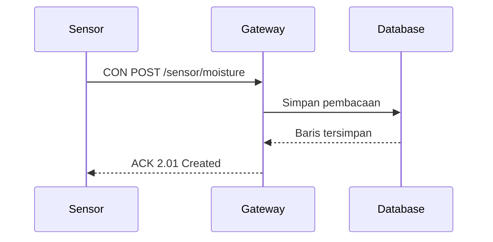
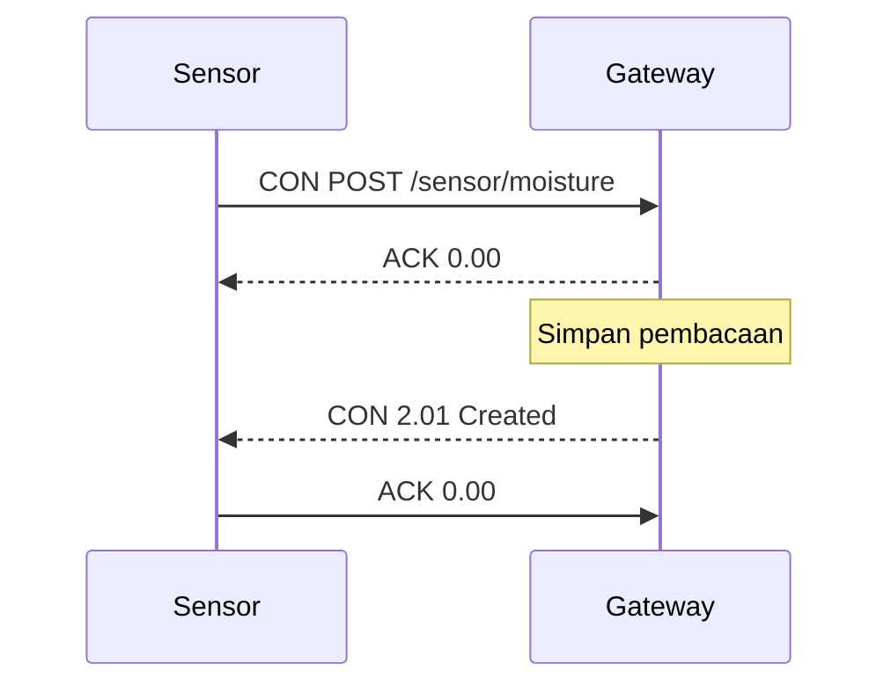

# Belajar CoAP untuk IoT

CoAP (Constrained Application Protocol) dipakai oleh perangkat terbatas untuk meminta atau mengubah resource, misalnya `coap://iot-gateway.local/sensor/moisture`. Bab ini memakai CoAP lewat UDP. Pilihan tipe pesan menentukan apakah pengirim menunggu konfirmasi penerimaan.

## Struktur dasar request CoAP

CoAP punya metode GET, POST, PUT, dan DELETE. Metode menentukan tindakan yang diminta. Tipe pesan menentukan cara pesan dikirim dan dikonfirmasi.

Contoh isi permintaan `POST /sensor/moisture`:

```json
{
  "device_id": "node-01",
  "moisture": 48.5
}
```

## Tipe pesan pada CoAP

| Tipe | Arti |
| --- | --- |
| Confirmable (CON) | Pengirim menunggu ACK. Jika ACK belum tiba, pengirim dapat mengirim ulang sampai batas percobaan. |
| Non-confirmable (NON) | Pesan dikirim tanpa menunggu ACK. Bila ada hasil aplikasi, server dapat mengirimkannya sebagai pesan terpisah. |
| Acknowledgement (ACK) | Mengonfirmasi penerimaan pesan CON. ACK bisa kosong atau membawa hasil permintaan. |
| Reset (RST) | Penerima melihat pesan tetapi tidak punya konteks untuk memprosesnya. |

## Siklus request-response CoAP dalam proyek AIoT

Anggap gateway menyimpan pembacaan sensor ke basis data. Bandingkan dua cara gateway menangani satu pesan CON.

### ACK membawa respons

Gateway selesai menyimpan pembacaan sebelum perlu mengirim ACK. Gateway menggabungkan ACK dan kode hasil `2.01 Created` dalam satu pesan. Ini disebut *piggybacked response*.



### ACK kosong dan respons terpisah

Jika penyimpanan butuh lebih lama, gateway dapat mengirim ACK kosong dulu. Saat ACK kosong tiba, sensor tahu pesan diterima dan berhenti mengulang permintaan. Hasil penyimpanan menyusul. Di contoh ini gateway mengirim hasil sebagai CON, sehingga sensor mengirim ACK untuk pesan baru itu.



Untuk telemetri berkala yang masih berguna ketika satu pembacaan hilang, coba bandingkan dengan `NON POST /sensor/moisture`. Sensor tidak menunggu ACK. Jika pesan hilang, lapisan pesan CoAP tidak mengirim ulang pesan NON itu.

Rujukan [RFC 7252 §4 tentang tipe pesan](https://www.rfc-editor.org/rfc/rfc7252.html#section-4) dan [§5.2 tentang respons](https://www.rfc-editor.org/rfc/rfc7252.html#section-5.2).

## Beberapa fitur tambahan CoAP

- **Observe** memungkinkan client meminta pemberitahuan ketika representasi resource berubah. [RFC 7641](https://www.rfc-editor.org/rfc/rfc7641.html).
- **Block-wise transfer** mengirim data besar dalam beberapa blok. [RFC 7959](https://www.rfc-editor.org/rfc/rfc7959.html).
- **DTLS** menyediakan pengamanan transport CoAP lewat UDP. [RFC 7252 §9](https://www.rfc-editor.org/rfc/rfc7252.html#section-9).
