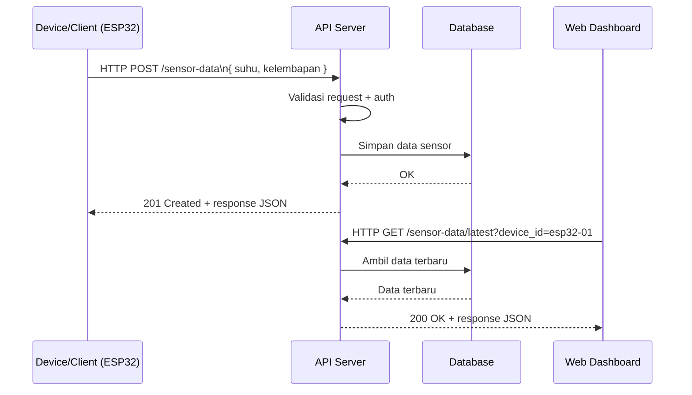

# Belajar HTTP untuk IoT

ESP32 mengirim pembacaan ke server. Server membalas dengan kode status dan, bila ada, isi respons. Jika pengiriman gagal, mulai dari metode, alamat, dan data yang benar-benar diterima server.

## Struktur dasar request HTTP

Secara umum, request berisi:

- Method: aksi yang diminta (GET, POST, PUT, DELETE).
- URL/Endpoint: alamat resource di server.
- Header: metadata request (contoh: Content-Type, Authorization).
- Body: data utama, biasanya dipakai di POST/PUT.

Contoh request POST untuk data sensor:

```http
POST /data HTTP/1.1
Content-Type: application/json

{
  "suhu": 26.7,
  "kelembapan": 56.3
}
```

## Tipe data pada request

Saat kirim request ke server, data bisa diletakkan di beberapa tempat. Tiga yang paling sering dipakai adalah query, request param (path param), dan request body.

### Query string

Query dipakai untuk filter, pencarian, sorting, atau pagination. Letaknya di URL setelah tanda `?`.

Contoh:

```text
GET /sensor/history?device_id=esp32-01&limit=10
```

Penjelasan singkat:

- `device_id=esp32-01` untuk pilih data milik device tertentu.
- `limit=10` untuk batasi jumlah data yang diambil.

### Request param (path param)

Request param dipakai saat kita ingin menunjuk resource yang spesifik lewat URL path.

Contoh pola endpoint:

```text
GET /sensor/:id
```

Contoh saat dipanggil:

```text
GET /sensor/123
```

Di sini, nilai `123` adalah path param `id`.

### Request body

Request body dipakai untuk mengirim data utama, biasanya pada method POST atau PUT.

Contoh:

```http
POST /sensor HTTP/1.1
Content-Type: application/json

{
  "device_id": "esp32-01",
  "suhu": 27.1,
  "kelembapan": 60.2
}
```

Body paling umum dipakai dalam format JSON karena mudah dibaca dan mudah diproses di backend.

## Method HTTP yang paling sering dipakai

### GET (Read)

Dipakai untuk mengambil data dari server.

Karakteristik:

- Umumnya tanpa body.
- Parameter sering dikirim lewat query string.
- Bisa di-cache oleh browser.

Contoh:

```text
GET /sensor/latest?id=123
```

### POST (Create)

Dipakai untuk mengirim dan membuat data baru.

Karakteristik:

- Data utama dikirim lewat body.
- Cocok untuk payload yang lebih besar dari query string.

Contoh penggunaan di AIoT:

- ESP32 kirim pembacaan sensor periodik ke endpoint server.

Contoh request:

```http
POST /sensor-data HTTP/1.1
Content-Type: application/json
{
  "device_id": "esp32-01",
  "suhu": 26.7,
  "kelembapan": 56.3
}
```

Browser akan mengirim request tersebut ke server, lalu server akan memproses data dan menyimpannya ke database.

### PUT (Update)

Dipakai untuk memperbarui data yang sudah ada.

Contoh:

- Update konfigurasi ambang batas suhu perangkat.

Contoh request:

```http
PUT /sensor/123 HTTP/1.1
Content-Type: application/json

{
  "suhu": 27.1,
  "kelembapan": 60.2
}
```

### DELETE (Delete)

Dipakai untuk menghapus resource tertentu.

Contoh:

- Hapus data sensor duplikat atau data uji.

Contoh request:

```http
DELETE /sensor/123 HTTP/1.1
```

## Siklus request-response dalam proyek IoT

1. Client mengirim request ke endpoint API.
2. Server validasi data (format, token, nilai wajib).
3. Server proses logika bisnis.
4. Server kirim response status dan data.

### Diagram alur request-response HTTP



Contoh status code yang sering muncul:

- 200 OK: request berhasil.
- 201 Created: data baru berhasil dibuat.
- 400 Bad Request: format/isi request tidak valid.
- 401 Unauthorized: butuh autentikasi.
- 500 Internal Server Error: ada error di sisi server.

Untuk melihat lebih lengkap, kalian bisa mengunjungi situs: [Status Code Reference](https://developer.mozilla.org/en-US/docs/Web/HTTP/Reference/Status)

## Tips praktik

- Selalu set Content-Type: application/json untuk payload JSON.
- Validasi nilai sensor sebelum dikirim (hindari data kosong/aneh).
- Cek status code di sisi client sebelum parsing response.
- Simpan endpoint API dalam variabel konfigurasi, jangan hardcode langsung di kode proyek, gunakan `.env` untuk menyimpan data penting seperti URL server, API Key, dan sebagainya.

## Telusuri permintaan sensor yang gagal

Jalankan [Backend Mini](../hands-on/backend-mini.md#jalankan-server). Kirim contoh JSON lengkap ke `POST /sensors` dan periksa kode 201 serta nilai yang dikembalikan. Hapus `value` lalu kirim ulang. Pada respons 400, baca pesan validasi. Jika alamatnya diganti ke rute yang tidak terdaftar, periksa respons 404.
