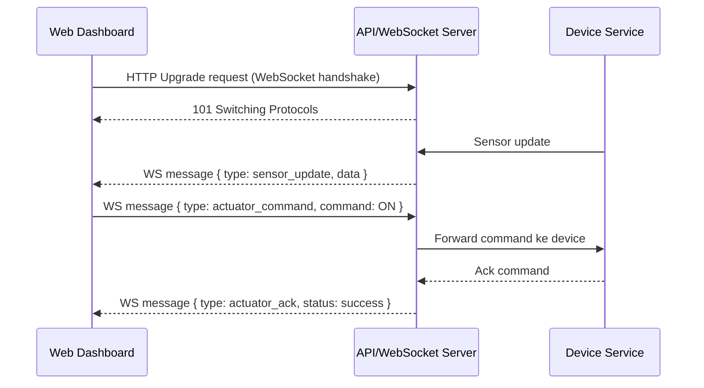

# Belajar WebSocket untuk IoT

Dashboard membuka koneksi WebSocket ke server. Selama koneksi terbuka, kedua pihak bisa mengirim pesan. Server bisa mengirim suhu terbaru tanpa menunggu dashboard meminta ulang. Perhatikan apa yang tampil ketika koneksi putus.

## Struktur dasar komunikasi WebSocket

Secara umum, prosesnya terdiri dari:

- Handshake awal melalui HTTP (upgrade ke WebSocket).
- Koneksi persisten setelah handshake berhasil.
- Pertukaran message frame (text atau binary).

Contoh endpoint:

```text
ws://localhost:8000/ws/sensor
wss://iot.example.com/ws/sensor
```

Contoh payload JSON:

```json
{
  "type": "sensor_update",
  "device_id": "esp32-01",
  "suhu": 27.4,
  "kelembapan": 61.2
}
```

## Tipe data pada WebSocket

Berbeda dari HTTP, WebSocket tidak memakai method GET/POST untuk setiap pesan setelah koneksi aktif. Data dikirim sebagai message.

| Tipe | Fungsi |
| --- | --- |
| Text Message | Kirim data dalam format string (biasanya JSON). |
| Binary Message | Kirim data dalam format biner untuk efisiensi. |
| Event Message | Tambahkan field `type` untuk membedakan jenis pesan. Contoh: `sensor_update`, `alert`, `actuator_ack`. |

## Fitur WebSocket yang paling sering dipakai

### Real-time push

Server bisa mengirim data ke client tanpa harus menunggu request baru.

### Low-latency update

Cocok untuk dashboard monitoring, notifikasi, dan kontrol perangkat yang membutuhkan respons cepat.

### Heartbeat / ping-pong

Digunakan untuk mendeteksi koneksi yang putus agar client dapat reconnect otomatis.

## Siklus komunikasi WebSocket dalam proyek AIoT

1. Client melakukan handshake ke endpoint WebSocket.
2. Server menerima koneksi dan melakukan autentikasi.
3. Client subscribe channel/topik logis (sesuai implementasi aplikasi).
4. Server push data sensor ke client secara real-time.
5. Client bisa kirim command kontrol ke server pada koneksi yang sama.

### Diagram alur komunikasi WebSocket



## Tips praktik

- Gunakan `wss://` di production agar trafik terenkripsi.
- Definisikan skema payload event sejak awal agar konsisten.
- Tambahkan mekanisme reconnect otomatis di frontend.
- Batasi frekuensi update jika data sangat tinggi agar dashboard tetap ringan.
- Pisahkan channel untuk data sensor dan command kontrol.

## Apa yang tampil saat koneksi putus?

Jika pembacaan terakhir 28,5 °C, lalu koneksi putus, dashboard bisa tetap menampilkan 28,5 °C dengan keterangan “koneksi putus” dan waktu pembacaan. Saat tersambung lagi, perbarui nilai setelah menerima data baru. Dengan begitu, peserta bisa membedakan pembacaan lama dari sambungan yang sudah pulih.
